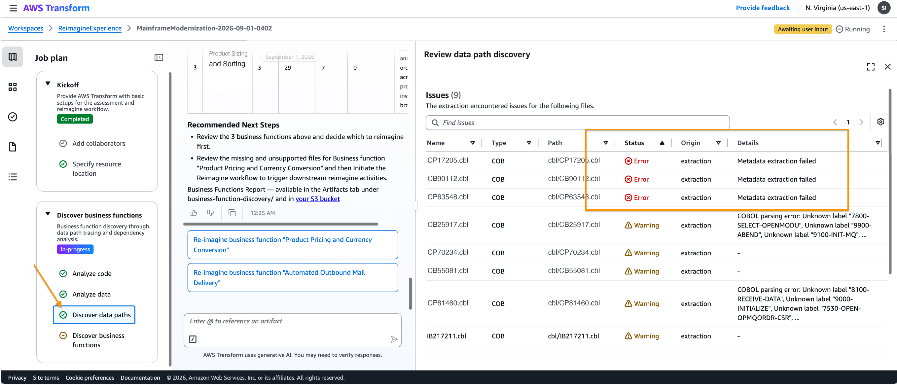
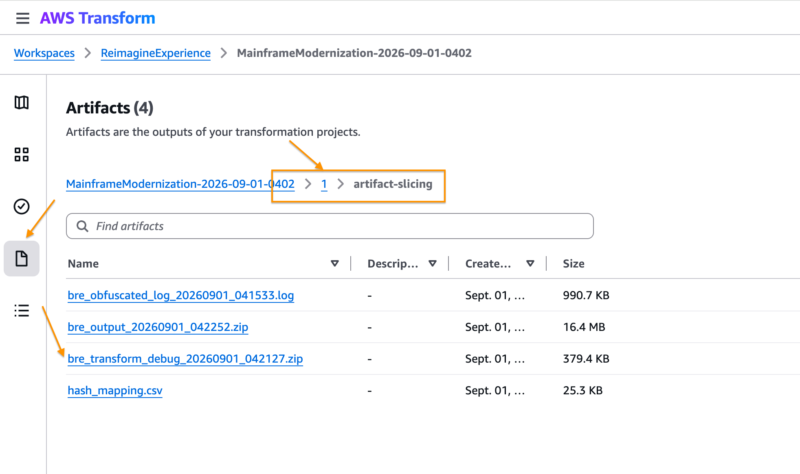

# ATX Fix BFD Code Issues

Plugin for diagnosing and resolving AWS Transform for mainframe (ATX)
"Discover data paths" extraction errors/warnings raised during business
function discovery (BFD), on mainframe codebases (COBOL, PL/I, and other
supported source languages). Part of the reverse-engineering phase of a
modernization with
[AWS Transform for mainframe](https://aws.amazon.com/transform/mainframe/).

| Skill | Description |
|---|---|
| [`fix-atx-datapath-errors`](skills/fix-atx-datapath-errors/SKILL.md) | Diagnose and fix ATX "Discover data paths" extraction errors/warnings on COBOL, PL/I, copybook, BMS, and JCL codebases |

## The problem

During AWS Transform's "Discover data paths" step in **Discover business functions** task, the **Issues** panel
lists extraction **Errors** and **Warnings** per artifact, with columns
for Name, Type, Path, Status, Origin, and Details:



Errors (e.g. "Metadata extraction failed") and Warnings (e.g. "COBOL
parsing error: Unknown label ...") appear in the **Status** column,
outlined above. These block or degrade downstream reimagine/business-
function-discovery steps. The root cause is rarely obvious from the
console message alone — it often requires the analyzer's diagnostic
bundle plus the original source to properly triage.

*The same approach can be adopted if you have selected "2. Reimagine" path as main objective at the start of the Mainframe Modernization job. The issue details are shown when you click the "Extract business logic" step.*

## Install

See the [root README](../../README.md#install) for every supported tool.
Quick reference:

```bash
# Claude Code
/plugin marketplace add aws-samples/sample-mainframe-modernization-agent-skills
/plugin install atx-fix-bfd-code-issue@mainframe-modernization

# Codex
codex plugin marketplace add aws-samples/sample-mainframe-modernization-agent-skills
codex plugin add atx-fix-bfd-code-issue@mainframe-modernization

# Kiro CLI, Cursor, GitHub Copilot, Devin, and other Agent Skills tools (skills CLI pinned to a tested release)
npx skills@1.7.4 add aws-samples/sample-mainframe-modernization-agent-skills --skill fix-atx-datapath-errors
```

## Prerequisites

- Python 3 installed and available on your `PATH` (check with
  `python3 --version`). No third-party packages are required — the
  skill's scripts use only Python's standard library.

## Collecting the diagnostic bundle

The diagnostic bundle needed to triage these issues is **not** the
Issues panel itself — it's a separate downloadable artifact. In the job's
**Artifacts** tab, navigate into **`1` → `artifact-slicing`** and
download **`bre_transform_debug_*.zip`** (not `bre_output_*.zip` or the
obfuscated log):



You'll also need the original source zip submitted to the job.

## Using the skill

1. In the workspace where you'll run the agent, create an `input/` folder
   and place both files in it:
   - `bre_transform_debug_*.zip`
   - the original source zip submitted to the AWS Transform job
2. Prompt the agent, e.g.: *"Use the fix-atx-datapath-errors skill to
   analyze the files in `input/` and fix what you can. Write results to
   `output/`."*

The agent writes `output/target_fixed.zip` (safe, business-rule-neutral
fixes applied; unfixable files removed and documented) and
`output/report.md` summarizing every finding, fix, and removal. Review the
report, then re-submit `target_fixed.zip` to AWS Transform. Full detail and
guardrails are in [`SKILL.md`](skills/fix-atx-datapath-errors/SKILL.md).

## License

This library is licensed under the MIT-0 License. See the [LICENSE](../../LICENSE) file.
